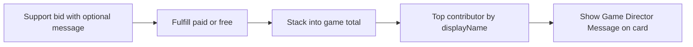

# Merge support + sponsor into Game Director Message

## Product rules (locked)

- **One checkout path:** support only (stacking). No new `sponsor` bids, no Claim/Outbid auction.
- **Optional fields on every support** (paid Polar and free $1): title, description, link, optional image URL — same sanitizers as today’s ad fields.
- **Who shows:** top contributor for that game by stacked `displayName` (`[aggregateContributors](server/utils/contributor.ts)`). Use that person’s **newest paid bid with a non-empty title** as the card message. If #1 left fields blank, show empty state (do not fall back to a lower contributor).
- **Card label:** “Game Director Message” (en) / natural Turkish equivalent (tr).
- **Full rename:** every user-facing and code-facing “sponsor” concept becomes Game Director / Game Director Message. No leftover sponsor UX, copy, or public identifiers.
- **Migration:** one-time `UPDATE bids SET bid_type = 'game' WHERE bid_type = 'sponsor'` so existing creatives become eligible under the new pick rule (and keep counting toward totals).

## Full rename sweep (mandatory)

Treat “sponsor” as banned in product language and public API after this change. Replace systematically:

| Old                                                                                                          | New                                                                               |
| ------------------------------------------------------------------------------------------------------------ | --------------------------------------------------------------------------------- |
| sponsor bid / claim sponsor / outbid                                                                         | support + optional Game Director Message                                          |
| `bidType: 'sponsor'`                                                                                         | removed for writes; migrate rows to `game`                                        |
| `sponsorCents` / `sponsorClaimCents` / `sponsorTitle`                                                        | drop claim cents; use `director` payload (message + optional cents from that bid) |
| `entry.ad` (sponsor creative)                                                                                | `entry.director` (Game Director Message)                                          |
| `sponsor_takeover` / sponsor decay copy                                                                      | `director_takeover` / director decay copy                                         |
| `TopSponsors.vue`                                                                                            | `TopDirectors.vue` (or equivalent)                                                |
| CSS `.sponsor-*`                                                                                             | `.director-*`                                                                     |
| i18n `sponsor*` / `claimSponsor` / `card.sponsor` / stats / activity / rules / how-to / seo / legal / footer | Game Director Message keys                                                        |
| Polar checkout sponsor branch                                                                                | single support product metadata (still non-advertising framing)                   |
| plaque “sponsor bid”                                                                                         | support bid; note if message included                                             |
| AGENTS.md sponsor auction prefs                                                                              | Game Director Message rules                                                       |

**Grep gate before done:** `sponsor` / `Sponsor` / `SPONSOR` should not remain in app/server/i18n/AGENTS except historical comments if unavoidable (prefer zero). DB column names `ad_`* may stay as storage (URL-only creative fields) without user-facing “ad/sponsor” wording; prefer calling them director fields in TypeScript helpers where touched.

## Backend

### Bid creation

- `[server/api/bids/create-checkout.post.ts](server/api/bids/create-checkout.post.ts)`: always `bidType: 'game'`. Accept optional director fields; if any provided, require sanitized title + description + link (image optional). Reject `bidType: 'sponsor'`.
- `[server/api/bids/claim-free.post.ts](server/api/bids/claim-free.post.ts)`: accept the same optional director fields (stop hardcoding empty `ad_*`).
- `[server/api/bids/quote.get.ts](server/api/bids/quote.get.ts)`: drop sponsor quote path; keep game projected rank/total.
- Remove sponsor-only validators (`getMinSponsorBidCents`, `validateSponsorBidCents`, `parseBidType` sponsor branch) from `[server/utils/bidding.ts](server/utils/bidding.ts)` / related.

### Selection + clicks

- Replace `pickWinningSponsorBid` with `pickGameDirectorMessage(gameBids)` (top aggregated contributor + newest message bid).
- Leaderboard / home / game detail payloads: `**director**` object (`bidId`, `title`, `description`, `link`, `image`, `clickCount`, `priceCents`) instead of `ad` / sponsor cents fields. Remove `sponsorClaimCents`.
- `[incrementAdClick](server/utils/bidding.ts)`: allow clicks for paid **game** bids with `adLink`. Optionally rename helper/route later; if renaming `/api/ads/click` → `/api/director/click`, update all callers in the same PR.
- `[server/utils/fulfill-bid.ts](server/utils/fulfill-bid.ts)`: emit `director_takeover` when the displayed message bid id changes; remove `sponsor_takeover`.
- `[server/utils/checkout-product.ts](server/utils/checkout-product.ts)`: single support product label/description; drop sponsor branch.
- Stats APIs: rename live/all-time sponsor metrics to director-message metrics (live messages, clicks, revenue tied to message bids if kept).
- Runtime migration in `[server/database/index.ts](server/database/index.ts)`: `sponsor` → `game`. Keep `bid_type` column (default `game`); stop writing `sponsor`. Schema `bidTypes` can become `['game']` only after migration.

### Decay / board events

- `[server/utils/board-events.ts](server/utils/board-events.ts)` + activity: rename all sponsor event types and payload fields (`previousSponsorTitle` → `previousDirectorTitle`, etc.).

## Frontend

### Bid modal

- `[BidModal.vue](app/components/BidModal.vue)`: remove game/sponsor tabs. Single Support flow + collapsible **Game Director Message** section (optional). Wire fields for paid and free.

### Cards + CTAs

- `[LeaderboardRow.vue](app/components/LeaderboardRow.vue)` / `[LeaderboardRowMinimal.vue](app/components/LeaderboardRowMinimal.vue)`: **Game Director Message** strip; remove Claim/Outbid; Support only.
- `[GameDetailModal.vue](app/components/GameDetailModal.vue)`, `[index.vue](app/pages/index.vue)`, `[Leaderboard.vue](app/components/Leaderboard.vue)`: drop all `claim-sponsor` / `openClaimSponsor` wiring.
- Rename `[TopSponsors.vue](app/components/TopSponsors.vue)` → Top Directors list of live Game Director Messages.
- `[SiteStats.vue](app/components/SiteStats.vue)`, `[ActivityFeed.vue](app/components/ActivityFeed.vue)`, plaque (`[p/[id].vue](app/pages/p/[id].vue)`), CSS in `[main.css](app/assets/css/main.css)`: full sponsor → director rename.

### i18n + docs

- `[en.json](i18n/locales/en.json)` + `[tr.json](i18n/locales/tr.json)`: replace every sponsor/claim/outbid string and key namespace with Game Director Message; update home/footer/rules/how-to/seo/legal.
- `[AGENTS.md](AGENTS.md)`: replace sponsor-auction prefs with Game Director Message rules.

## Out of scope

- User accounts / editing message after checkout without a new support bid.
- File upload for images (URL-only stays).
- Dropping `ad_*` SQLite columns (storage only; semantics = director message fields).

