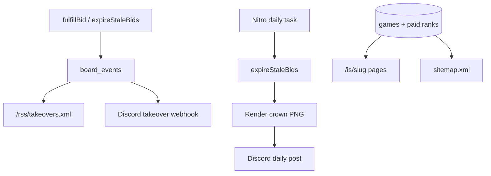

# Growth: Discord, RSS, SEO pages, launch kit

## Locked decisions

- **1A:** Nitro daily task renders a crown PNG for current `#1` and POSTs it to a Discord webhook. Reddit / X are a **manual ops checklist** only (no API bots).
- **2A:** Crawlable SEO pages + static launch kit for Product Hunt / itch.io. No auto-submit.
- **Also ship:** live Discord takeover pings + public RSS of takeovers.
- **Explicitly out:** weekly archive, dark mode / theme toggle.

## Architecture




## 1. Discord + RSS (reuse `board_events`)

**Env** (private runtimeConfig + `[.env.example](.env.example)`):

- `NUXT_DISCORD_WEBHOOK_URL` — optional; no-op when empty so local/dev stays quiet.

**Live takeovers** — after `insertBoardEvent` in `[server/utils/fulfill-bid.ts](server/utils/fulfill-bid.ts)` when `type === 'rank_takeover'` and `toRank === 1`, fire-and-forget `notifyDiscordTakeover(...)` in a new `[server/utils/discord.ts](server/utils/discord.ts)`. Never fail bid fulfillment if Discord errors. Embed: game title, from→to rank, contributor, amount, links to site + `/is/{slug}` when slug known.

**RSS** — new `[server/routes/rss/takeovers.xml.ts](server/routes/rss/takeovers.xml.ts)`:

- Query `board_events` for `rank_takeover` (and `director_takeover`), newest first, limit ~50.
- Extend `[getRecentBoardEvents](server/utils/board-events.ts)` with optional `types` + higher limit (or a dedicated `getTakeoverFeedEvents`).
- RSS 2.0 XML, `Cache-Control: public, max-age=60`.
- Item link: home with hash or `/is/{slug}`; guid = event id.
- Link from footer (small “Takeovers RSS”) via existing footer in `[app/app.vue](app/app.vue)` + i18n keys.

## 2. Daily crown Discord post (1A)

**Nitro task** — enable in `[nuxt.config.ts](nuxt.config.ts)`:

```ts
nitro: {
  experimental: { tasks: true },
  scheduledTasks: {
    '0 15 * * *': ['crown-daily'] // 15:00 UTC daily
  }
}
```

New `[server/tasks/crown-daily.ts](server/tasks/crown-daily.ts)`:

1. `expireStaleBids()` so crown is current.
2. Read rank-1 from cached leaderboard helpers.
3. If empty board, exit quietly.
4. Render crown card SVG (arcade style, reuse palette from `[server/utils/embed-badge.ts](server/utils/embed-badge.ts)`) → PNG via `**@resvg/resvg-js**` (new dep; fits Node/Coolify + existing native-addon deploy).
5. POST multipart to Discord webhook (`files[0]` + caption: title, total, link).

Optional public preview route `[server/api/og/crown.get.ts](server/api/og/crown.get.ts)` (`image/png`) for debugging and as Discord `image.url` fallback — same renderer as the task.

**Ops checklist** (manual Reddit / X) lives in the launch kit below — not automated.

## 3. Programmatic SEO pages (2A)

**Route:** `[app/pages/is/[slug].vue](app/pages/is/[slug].vue)` → `/is/{slug}` and `/tr/is/{slug}`.

- Resolve game from local `games.slug` (only games that have entered the board via a bid — avoids thin IGDB spam).
- Attach live rank via existing board helpers (`getGameBoardPosition` / games API pattern from `[server/api/games/[id].get.ts](server/api/games/[id].get.ts)`).
- **H1:** “Is {title} the best game right now?” (TR equivalent in `[i18n/locales/tr.json](i18n/locales/tr.json)`).
- Body: current rank or “not on the board yet”, stacked total, short summary, CTA to open bid flow (reuse `openBidModal` inject / deep-link query already used on home).
- SEO: `useSiteSeo` with unique title/description, OG image = cover or crown OG, FAQ/WebPage JSON-LD answering the question from live rank (`rank === 1` → yes; else no + CTA).
- 404 if slug unknown in DB.

**API helper:** `[server/api/games/by-slug/[slug].get.ts](server/api/games/by-slug/[slug].get.ts)` (or shared util used by the page) mirroring games-by-id + board fields.

**Sitemap:** extend `[server/routes/sitemap.xml.ts](server/routes/sitemap.xml.ts)` to append `/is/{slug}` (en+tr) for all rows in `games` with a non-empty slug. `changefreq: daily`, priority ~0.7.

**Discoverability:** from `[GameDetailModal.vue](app/components/GameDetailModal.vue)` / podium rows, add a quiet “Is this the best?” link to `/is/{slug}` when slug exists — one line, no new nav section.

## 4. Launch kit (Product Hunt / itch.io + Reddit / X)

Add markdown under `[docs/launch/](docs/launch/)` (not user-facing product UI):


| File                    | Contents                                                                                                                                       |
| ----------------------- | ---------------------------------------------------------------------------------------------------------------------------------------------- |
| `product-hunt.md`       | Tagline, description, maker comment, first-comment script, gallery shot list                                                                   |
| `itch-io.md`            | Tools-category blurb, page sections, embed badge snippet pointing at `/embed/{id}.svg`                                                         |
| `daily-crown-social.md` | Manual Reddit / X / Discord community checklist: when to post, caption templates, attach crown PNG from `/api/og/crown` or Discord bot message |
| `README.md`             | “Ship when the board feels busy” gate + env vars for Discord                                                                                   |


Polar/AUP-safe language only (board participation / entertainment — no “ads”, “sponsorship”, “rank boost”).

## 5. Config / docs touchups

- Wire `discordWebhookUrl` in `runtimeConfig`.
- Note Discord + cron in root `[README.md](README.md)` API/ops section.
- Do **not** edit attached plan files under `.cursor/plans/`.

## Verification

- Empty `NUXT_DISCORD_WEBHOOK_URL`: fulfillments and cron still succeed; no Discord calls.
- With webhook: crown `#1` takeover posts once; daily task posts PNG.
- `/rss/takeovers.xml` validates as RSS and lists recent events.
- `/is/{known-slug}` SSR’s live rank + i18n; unknown slug 404s.
- Sitemap includes new `/is/...` URLs.
- No theme toggle / archive code paths introduced.

