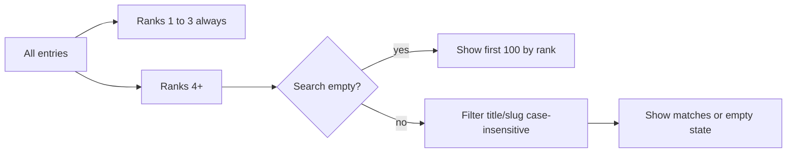

# Turkish i18n, legal pages, slideovers, and board search

## Defaults (stated so we can ship without blocking)

- **Default locale:** English (`en`). Turkish (`tr`) via nav/footer switcher. Strategy: `@nuxtjs/i18n` with `strategy: 'prefix_except_default'` (`/` = EN, `/tr/...` = TR).
- **Legal contact placeholder:** Operator styled as **mybestgame.lol**; contact **[privacy@mybestgame.lol](mailto:privacy@mybestgame.lol)** (swap later if you give a real entity/email).
- **Rules / How to play:** Nuxt UI `USlideover` panels (not full pages), opened from header + footer. Legal docs stay as **full pages**.
- **Board search:** Client-side on existing `/api/leaderboard` payload (already unbounded). No new API.

## 1. i18n infrastructure

- Add `@nuxtjs/i18n` and register in `[nuxt.config.ts](nuxt.config.ts)`.
- Locale files:
  - `[i18n/locales/en.json](i18n/locales/en.json)`
  - `[i18n/locales/tr.json](i18n/locales/tr.json)`
- Key by surface: `nav`, `home`, `leaderboard`, `bid`, `activity`, `stats`, `archive`, `success`, `plaque`, `rules`, `howto`, `legal`, `footer`, `errors`.
- Wire `t()` / `$t` across shell and components (highest density first):
  - `[app/app.vue](app/app.vue)`
  - `[app/pages/index.vue](app/pages/index.vue)`, `[success.vue](app/pages/success.vue)`, archive + plaque pages
  - `[BidModal.vue](app/components/BidModal.vue)`, `[Leaderboard.vue](app/components/Leaderboard.vue)`, rows, `[ActivityFeed.vue](app/components/ActivityFeed.vue)`, `[GameDetailModal.vue](app/components/GameDetailModal.vue)`, stats/search helpers
- Locale-aware `Intl` / relative time via active locale (keep **USD** currency display).
- SEO: `useSeoMeta` titles/descriptions from i18n; `htmlAttrs.lang` from locale module (drop hard-coded `en` in `app.vue`).
- Compact **EN | TR** switcher in header (and footer on mobile).

**Copy tone:** EN stays playful arcade. TR is natural spoken Turkish with light humor (not literal machine translation). Prefer short punchy lines over stiff legal-ish UI. User-facing word remains **sponsor** (not “ad”) in both languages.

## 2. Mobile responsive (must)

Audit and fix chrome so TR longer labels still fit:

- Show **Archive** (and Rules / How to play) on small screens: compact icon+label or overflow menu; stop hiding Archive behind `hidden sm:inline-flex` only.
- Header actions: wrap/`gap` so bid CTA + locale + help links do not overflow; keep touch targets ≥44px.
- Leaderboard minimal rows, BidModal tabs, podium cards: allow text wrap / truncate with `min-w-0`, stack actions on narrow widths (extend existing `sm:` patterns).
- Footer: stacked legal link grid that does not jam to edges.
- Spot-check at ~375px and ~390px after TR strings land.

## 3. Legal pages (EN + TR, detailed, protective)

New pages under `app/pages/` (i18n-prefixed automatically):

| Route      | Purpose                                                                     |
| ---------- | --------------------------------------------------------------------------- |
| `/privacy` | What we store, processors, public display, retention, rights                |
| `/terms`   | Service terms, bidding rules, non-refundable, no warranties                 |
| `/gdpr`    | GDPR-style notice (controller, legal bases, processors, requests)           |
| `/cookies` | Cookies / Turnstile / essential tech; no marketing trackers claimed if none |
| `/refunds` | All sales final; Polar handles payment disputes; no rank guarantees         |

Shared layout component e.g. `[app/components/LegalPage.vue](app/components/LegalPage.vue)`: readable long-form, light theme, last-updated date. Body copy lives in locale JSON (or `en`/`tr` markdown sections) so both languages stay in sync structurally.

**Accurate data story (matches code, not marketing wish):**

- No user accounts/passwords.
- Public board shows game rank totals, optional **handle/name** (column renamed to `display_name`; see §7), sponsor title/link/image URL/description, click counts, masked contributor labels.
- Payment fulfillment via **Polar.sh** (checkout IDs/order IDs); Polar may process payment PII under their policies.
- Bot protection: Cloudflare Turnstile; in-memory IP rate limits (not long-term profiling).
- Game metadata from **IGDB** (third party); we are not affiliated with publishers/Nintendo/IGDB/Twitch.
- Bids expire after **30 days** (`BID_EXPIRY_DAYS`); ranks change; weekly archives are snapshots.

**Liability posture (both languages, lawyer-style thoroughness):**

- Entertainment / promotional ranking only; not investment advice; no endorsement of games.
- **All payments non-refundable** once paid (and pending abandoned checkouts never appear on the board).
- No guarantee of rank, traffic, clicks, sponsor visibility, or business outcome.
- Sponsor content is user-submitted; we may remove without notice; user warrants they have rights; indemnify the site.
- Service “as is”; cap/exclude liability to the maximum extent allowed; no consequential damages.
- We may change rules, expire bids, archive weeks, or shut down features.
- Governing law / venue: state as **laws of the operator’s jurisdiction** with a clear “to the extent permitted” disclaimer (placeholder jurisdiction: Turkey if TR-facing product, or “as determined by operator” — use **Republic of Turkey** + Istanbul courts unless you specify otherwise).
- Not legal advice; pages do not create fiduciary duties.

Footer links to all five pages + Privacy/Terms in both locales.

> Note: These pages reduce risk but are **not** a substitute for a lawyer review before real money at scale.

## 4. Rules + How to play slideovers

- Components: `[app/components/RulesSlideover.vue](app/components/RulesSlideover.vue)`, `[app/components/HowToPlaySlideover.vue](app/components/HowToPlaySlideover.vue)` using `USlideover`.
- Mount from `[app/app.vue](app/app.vue)`; open via provide/inject or small composable (`useSiteHelp`).
- Nav/footer buttons: “Rules” / “How to play” (TR: natural equivalents, e.g. “Kurallar” / “Nasıl oynanır”).

**Content (aligned with product rules):**

- How to play: pick game → choose Support vs Sponsor → pay via Polar → only **paid** bids count → board updates.
- Rules: $1 min game stack; pay only the increment when stacking; sponsor must beat current by ≥ $1; highest paid sponsor holds the spot; 30-day expiry / decay; weekly archive; no refunds; keep sponsor copy clean; identity optional.

Tone matches UI: clear + a little funny, not corporate.

## 5. Rank 4+ search (first 100 visible)

Change only `[app/components/Leaderboard.vue](app/components/Leaderboard.vue)` (and archive reuse):

- Search `UInput` above “Ranks 4 and below” (hidden when `readOnly` archive if preferred — **enable on live board; keep on archive too** for consistency).
- Default: `rank > 3` sorted by rank, **slice(0, 100)**.
- With query (≥1–2 chars): filter full `rank > 3` list by title (and slug); no 100 cap while searching.
- Empty search results: short funny localized empty state (“Nothing on this shelf. Try another title.”).
- Hint under input when not searching: e.g. “Showing top 100 of the pack. Search to dig deeper.” with count when total > 100.
- Podium (1–3) never filtered by this search.

## 6. Polar checkout Turkish (in scope)

Polar supports Turkish checkout UI (`locale: "tr"`) in [Checkout Localization](https://polar.sh/docs/features/checkout/localization) (beta; **enable the org feature flag** in Polar dashboard).

- In [`server/api/bids/create-checkout.post.ts`](server/api/bids/create-checkout.post.ts), accept optional `locale` from the client (`en` | `tr`) and pass it into `polar.checkouts.create({ locale })`.
- Client (`BidModal` / checkout caller): send the active `@nuxtjs/i18n` locale so TR UI → Turkish Polar checkout, EN → English.
- Fallback: if locale missing/unsupported, Polar defaults to `en`.
- Known Polar beta limits (document in README briefly): error messages and receipt emails may stay English; no in-checkout language picker.
- Do **not** invent custom Polar UI strings — Polar owns checkout chrome; we only set `locale`.

## 7. Schema cleanup: rename `email` → `display_name` (not drop)

`bids.email` is **not unused**. It stores the optional public handle/name used for contributor labels, plaques, stats (`count(distinct …)`), and pending-bid dedupe. Dropping it would break those features.

**Chosen approach:** rename the column to match reality.

- Drizzle schema ([`server/database/schema.ts`](server/database/schema.ts)): `email` → `displayName: text('display_name').notNull()`.
- SQLite bootstrap in [`server/database/index.ts`](server/database/index.ts): create/`ALTER TABLE bids RENAME COLUMN email TO display_name` for existing DBs (SQLite 3.25+).
- Update all readers/writers: bidding utils, fulfill-bid, contributor aggregation/masking, create-checkout, seeds/scripts (`seed-leaderboard`, verify scripts).
- API body: keep `displayName` only; remove deprecated `email` request field.
- Stop treating display name as Polar `customerEmail` by default (that path conflated handle with payment email). Polar collects payer email on its own checkout form.
- Audit: no other columns are dead (`ad_*` still used for sponsor; payment IDs still used). No broader drop.

Legal copy should say we store an optional **public display name**, not an email address, unless the user types one as their handle.

## 8. Out of scope

- Custom Polar receipt/email translation (Polar beta limitation).
- Dropping bidder identity entirely (anonymous-only board).
- Lawyer-signed contracts or real company registration details beyond placeholders.

## Implementation order

1. Install/configure `@nuxtjs/i18n` + EN/TR message scaffolds.
2. Extract UI strings; write natural funny TR.
3. Wire Polar `locale` from active UI locale + enable Polar org localization flag (ops note).
4. Rename `email` → `display_name` (schema + migration + call sites).
5. Legal pages + footer links.
6. Rules / How-to-play slideovers + header/footer entry points.
7. Leaderboard search + 100-cap.
8. Mobile pass with TR strings; typecheck.

