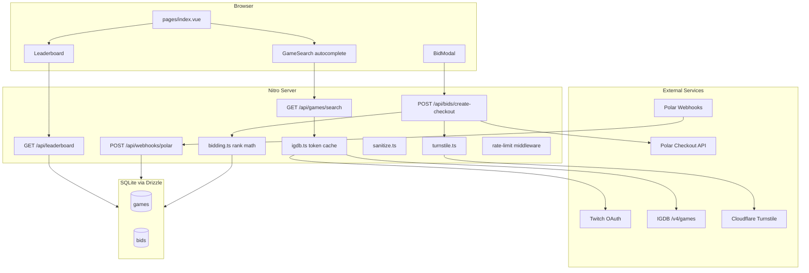
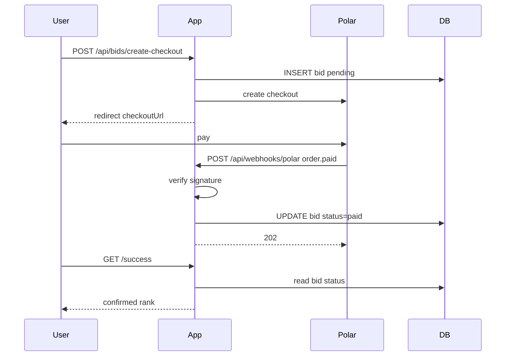

# mybestgame.lol — Implementation Plan

## Context

- **Workspace:** empty git repo at `[/Users/erbilnas/Documents/Projects/my-best-game](/Users/erbilnas/Documents/Projects/my-best-game)` — build from scratch.
- **Reference mechanics:** [outbid.lol](https://outbid.lol/) (stacking bids, rank = total paid, ties broken by earlier bid).
- **Confirmed decisions:**
  - **Stacking bids** on the same game (pay only the increment when raising).
  - `**ad_image` as URL only** in v1 (no object storage).

## Architecture




## Step 1 — Scaffold Nuxt 3 + Nuxt UI

Initialize with the official Nuxt starter, then add modules:

```bash
npx nuxi@latest init . --force
npx nuxi@latest module add @nuxt/ui
```

**Key files:**

- `[nuxt.config.ts](nuxt.config.ts)` — `@nuxt/ui`, runtime config for secrets, Nitro `routeRules` for webhook raw body.
- `[app.config.ts](app.config.ts)` — Nuxt UI theme tokens (dark arcade palette; avoid default blue-purple slop).
- `[.env.example](.env.example)` — document all required vars (no secrets committed).

**Runtime config shape:**

```ts
runtimeConfig: {
  twitchClientId: '',
  twitchClientSecret: '',
  polarAccessToken: '',
  polarWebhookSecret: '',
  polarProductId: '',
  turnstileSecretKey: '',
  databaseUrl: './data/mybestgame.db',
  public: {
    siteUrl: 'https://mybestgame.lol',
    turnstileSiteKey: '',
    polarServer: 'sandbox', // 'production' in prod
  }
}
```

**Deployment target:** Node server (not Cloudflare Workers) so file-based SQLite with `better-sqlite3` works.

## Step 2 — Drizzle ORM + SQLite schema

**Dependencies:** `drizzle-orm`, `better-sqlite3`, `drizzle-kit` (dev).

**Schema** in `[server/database/schema.ts](server/database/schema.ts)`:


| Table   | Purpose                                                                                                                                                                                                                  |
| ------- | ------------------------------------------------------------------------------------------------------------------------------------------------------------------------------------------------------------------------ |
| `games` | Cached IGDB entries: `id` (IGDB int PK), `title`, `coverUrl`, `slug`, `createdAt`                                                                                                                                        |
| `bids`  | Individual paid increments: `id`, `gameId`, `email`, `amount` (cents), `adTitle`, `adLink`, `adImage`, `status` (`pending` | `paid` | `expired` | `failed`), `polarCheckoutId`, `polarOrderId`, `expiresAt`, `createdAt` |


**No separate `leaderboard` table** — compute rank from aggregated active bids (simpler, always consistent):

```sql
-- conceptual query
SELECT game_id, SUM(amount) AS total_cents
FROM bids
WHERE status = 'paid' AND expires_at > unixepoch()
GROUP BY game_id
ORDER BY total_cents DESC, MIN(created_at) ASC
```

**Bid expiry:** 30 days per paid bid (matches outbid.lol). A nightly Nitro scheduled task or lazy expiry on read marks expired bids.

**Files:**

- `[server/database/index.ts](server/database/index.ts)` — singleton Drizzle client
- `[drizzle.config.ts](drizzle.config.ts)`
- `[server/database/migrations/](server/database/migrations/)` — initial migration via `drizzle-kit push` / `generate`

## Step 3 — IGDB game search proxy

**Route:** `[server/api/games/search.get.ts](server/api/games/search.get.ts)` — `?q=zelda&limit=10`

**Utility:** `[server/utils/igdb.ts](server/utils/igdb.ts)`

- Cache Twitch app access token in memory with 60s expiry buffer.
- POST `https://api.igdb.com/v4/games` with Apicalypse body:
  ```
  search "query"; fields name, slug, cover.image_id; limit 10;
  ```
- Normalize cover URLs: `https://images.igdb.com/igdb/image/upload/t_cover_big/{image_id}.jpg`
- **Query cache:** in-memory LRU (or Nitro storage) keyed by normalized query, TTL 5 min, to reduce IGDB rate limits (4 req/s per client ID).

**On game selection during checkout:** upsert into `games` table before creating bid.

## Step 4 — Bidding logic (stacking model)

**Utility:** `[server/utils/bidding.ts](server/utils/bidding.ts)`

Rules (aligned with your spec + outbid.lol stacking):


| Case                     | Rule                                           |
| ------------------------ | ---------------------------------------------- |
| First bid on a new game  | min **$1** increment                           |
| Raise same game          | min **$1** additional increment                |
| Beat another game's rank | new total must be **≥ target rank total + $1** |
| Ties                     | earlier `createdAt` wins (stable sort)         |
| Checkout amount          | **increment only** (not full target total)     |


**Rank preview endpoint** (optional but UX-critical): `GET /api/bids/quote?gameId=&amount=` returns `{ incrementCents, projectedRank, currentTotalCents }` so the bid modal can show "You'll pay $X and reach rank #Y".

**Concurrency:** wrap checkout creation + pending bid insert in a SQLite transaction; re-validate minimums inside the transaction to prevent race on hot #1 spot.

## Step 5 — UI (Nuxt UI components)

**Pages:**

- `[pages/index.vue](pages/index.vue)` — hero + live leaderboard + bid CTA
- `[pages/success.vue](pages/success.vue)` — post-checkout confirmation (poll bid status until `paid` or timeout)

**Components:**

- `[components/GameSearch.vue](components/GameSearch.vue)` — `UInputMenu` / combobox with debounced IGDB search
- `[components/Leaderboard.vue](components/Leaderboard.vue)` — ranked list: rank, cover, title, total bid, latest ad (title + link + image)
- `[components/BidModal.vue](components/BidModal.vue)` — game picker, amount, email, ad fields, Turnstile widget, submit
- `[components/LeaderboardRow.vue](components/LeaderboardRow.vue)` — single row with sponsored link (`rel="sponsored nofollow"`)

**Design direction:** functional leaderboard-first layout inspired by outbid.lol/memleket.lol — dense rank table, game cover thumbnails, minimal chrome. Nuxt UI primitives (`UCard`, `UModal`, `UButton`, `UInput`, `UBadge`) with a warm dark palette and system-ui body (no Google-font slop defaults).

**Data fetching:** `useFetch('/api/leaderboard')` with SSR on index; client poll every 30s or use SSE later.

## Step 6 — Polar.sh checkout integration

**Polar dashboard setup (manual, documented in README):**

1. Create a **fixed-price or PWYW product** with **$1 minimum**.
2. Prefer **ad-hoc checkout prices** per session for exact increment amounts (avoids catalog clutter).
3. Register webhook endpoint: `https://mybestgame.lol/api/webhooks/polar`
4. Subscribe to: `checkout.updated`, `order.paid` (fulfill on `order.paid`).

**Route:** `[server/api/bids/create-checkout.post.ts](server/api/bids/create-checkout.post.ts)`

Flow:

1. Verify Turnstile token.
2. Validate + sanitize inputs.
3. Compute increment via `bidding.ts`.
4. Insert `bids` row (`status: pending`).
5. Call Polar SDK:

```ts
const checkout = await polar.checkouts.create({
  products: [productId],
  prices: { [productId]: [{ amountType: 'fixed', priceAmount: incrementCents, priceCurrency: 'usd' }] },
  customerEmail: email,
  metadata: { bidId, gameId, incrementCents },
  successUrl: `${siteUrl}/success?bid_id={CHECKOUT_ID}`,
});
```

1. Store `polarCheckoutId` on bid; return `{ checkoutUrl }`.

**Utility:** `[server/utils/polar.ts](server/utils/polar.ts)` — SDK singleton.

## Step 7 — Polar webhook handler

**Route:** `[server/api/webhooks/polar.post.ts](server/api/webhooks/polar.post.ts)`

**Critical:** Nitro must receive **raw body** for signature verification. In `[nuxt.config.ts](nuxt.config.ts)`:

```ts
nitro: {
  routeRules: {
    '/api/webhooks/polar': { bodyParser: false }
  }
}
```

Handler:

1. Read raw body via `readRawBody(event)`.
2. `validateEvent(rawBody, headers, polarWebhookSecret)` from `@polar-sh/sdk/webhooks`.
3. On `order.paid`:
  - Read `metadata.bidId`.
  - Idempotent update: only transition `pending → paid` if still pending.
  - Set `expiresAt = now + 30 days`, store `polarOrderId`.
4. Return `202` quickly; never update rank on client-side redirect alone.




## Step 8 — Security hardening


| Control            | Implementation                                                                                                                                                 |
| ------------------ | -------------------------------------------------------------------------------------------------------------------------------------------------------------- |
| Turnstile          | `[server/utils/turnstile.ts](server/utils/turnstile.ts)` — verify on `create-checkout` only                                                                    |
| Rate limit         | `[server/middleware/rate-limit.ts](server/middleware/rate-limit.ts)` using `h3-rate-limit` — 10 req/min/IP on checkout + search                                |
| Input sanitization | `[server/utils/sanitize.ts](server/utils/sanitize.ts)` — strip HTML from `adTitle`; validate `adLink` is `http:`/`https:` only (reject `javascript:`, `data:`) |
| Webhook trust      | signature verification only; ignore unsigned payloads                                                                                                          |
| Amount integrity   | never trust client amount; server computes increment from DB state                                                                                             |
| Email              | basic format validation; store lowercase trimmed                                                                                                               |


**Env vars in `.env.example`:**

```
TWITCH_CLIENT_ID=
TWITCH_CLIENT_SECRET=
POLAR_ACCESS_TOKEN=
POLAR_WEBHOOK_SECRET=
POLAR_PRODUCT_ID=
TURNSTILE_SECRET_KEY=
NUXT_PUBLIC_TURNSTILE_SITE_KEY=
NUXT_PUBLIC_SITE_URL=http://localhost:3000
DATABASE_URL=./data/mybestgame.db
```

## File tree (target)

```
my-best-game/
├── app.vue
├── app.config.ts
├── nuxt.config.ts
├── drizzle.config.ts
├── package.json
├── .env.example
├── pages/
│   ├── index.vue
│   └── success.vue
├── components/
│   ├── GameSearch.vue
│   ├── Leaderboard.vue
│   ├── LeaderboardRow.vue
│   └── BidModal.vue
├── server/
│   ├── api/
│   │   ├── games/search.get.ts
│   │   ├── leaderboard.get.ts
│   │   ├── bids/
│   │   │   ├── quote.get.ts
│   │   │   └── create-checkout.post.ts
│   │   └── webhooks/polar.post.ts
│   ├── database/
│   │   ├── index.ts
│   │   └── schema.ts
│   ├── middleware/
│   │   └── rate-limit.ts
│   └── utils/
│       ├── igdb.ts
│       ├── polar.ts
│       ├── bidding.ts
│       ├── sanitize.ts
│       └── turnstile.ts
└── data/            # gitignored SQLite file
```

## Implementation order

Execute in dependency order — each step should be runnable before moving on:

1. Nuxt + Nuxt UI scaffold, env template, basic layout
2. Drizzle schema + migration + seed script
3. IGDB search API + `GameSearch` component
4. Leaderboard query API + `Leaderboard` UI (empty state first)
5. Bidding math utility + quote endpoint
6. Polar checkout endpoint + `BidModal` wired end-to-end (sandbox)
7. Webhook handler + success page polling
8. Turnstile + rate limit + sanitization pass
9. Manual test checklist (sandbox payment → rank updates only after webhook)

## Testing checklist (manual, sandbox)

- Search returns IGDB games with covers
- First bid $1 on new game creates checkout for $1
- Paying in Polar sandbox moves game onto leaderboard
- Second bid on same game charges increment only
- Outbidding another game requires correct minimum
- Invalid `javascript:` ad link rejected
- Forged webhook rejected (403)
- Duplicate webhook delivery is idempotent (no double-count)
- Expired bids drop from rank totals

## Out of scope for v1

- User accounts / OAuth login (email only on bid)
- Image file upload
- Admin dashboard
- Bid refunds / chargebacks automation
- Real-time WebSocket updates (polling is fine for v1)

## Risks and mitigations


| Risk                                     | Mitigation                                        |
| ---------------------------------------- | ------------------------------------------------- |
| Polar sandbox vs production mismatch     | `POLAR_SERVER` env flag; document dashboard setup |
| SQLite write contention on viral traffic | acceptable for v1; migrate to Turso/D1 if needed  |
| IGDB rate limits                         | token cache + query LRU + debounced search        |
| Webhook replay                           | idempotent `bidId` status transition              |
| Concurrent #1 bids                       | transactional re-validation in `create-checkout`  |


