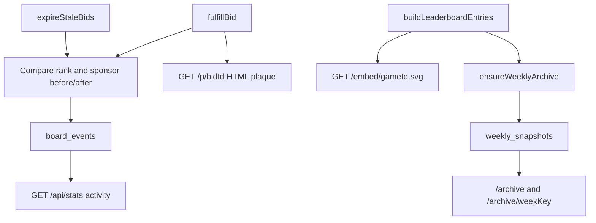

# Plaques, decay/takeover, weekly archive, embed badges

## Defaults (locked)

- **No new npm deps.** Plaques are HTML + CSS; social preview uses IGDB `coverUrl` as `og:image` plus rich title/description. Cards/embeds are hand-authored SVG strings.
- **Payment rules unchanged.** Still fulfill only on `order.paid` / checkout `succeeded` in `[server/utils/fulfill-bid.ts](server/utils/fulfill-bid.ts)`.
- **Week key:** ISO week `YYYY-Www` in UTC. Snapshot previous week lazily on first archive/leaderboard hit after the boundary; also register a Nitro scheduled task Monday 00:05 UTC as backup.
- **Events:** append-only `board_events` table; activity feed becomes typed moments (not only new paid bids).

## Architecture

## Schema (`[server/database/schema.ts](server/database/schema.ts)`)

Add two tables:

- `board_events`: `id`, `type` (`bid_paid` | `rank_takeover` | `sponsor_takeover` | `decay`), `gameId`, `bidId` nullable, `payload` JSON text (titles, ranks, amounts, previous holder), `createdAt`
- `weekly_snapshots`: `weekKey` PK, `crownedGameId` nullable, `crownedTitle`, `crownedTotalCents`, `entriesJson` (array shaped like `LeaderboardEntryPayload`), `createdAt`

Run `pnpm db:push` after schema change.

## 1. Plaque / share cards

**Server**

- Enrich `[server/api/bids/status.get.ts](server/api/bids/status.get.ts)` (and confirm path as needed) so a `paid` bid returns: `bidType`, `gameTitle`, `slug`, `coverUrl`, `rank`, `totalCents`, `amount`, `expiresAt`, `contributor` (masked), sponsor ad title if sponsor.
- New page `[app/pages/p/[id].vue](app/pages/p/[id].vue)`: public plaque for paid bids only (404 otherwise). Arcade plaque UI using existing tokens in `[app/assets/css/main.css](app/assets/css/main.css)`: cover, `#rank`, amount, game title, expiry countdown, Copy link + Web Share.
- `useSeoMeta` on plaque: title like `#3 Elden Ring · $42 on mybestgame.lol`, description with contributor + expiry, `ogImage` = absolute `coverUrl` when present else site fallback favicon/`siteUrl`.
- Optional light SVG preview route `GET /api/og/bid/[id].svg` for on-page “share card” visual (same data); not required for crawlers.

**UI hooks**

- `[app/pages/success.vue](app/pages/success.vue)`: when paid, show mini plaque + primary CTA “View plaque” → `/p/{id}`, secondary “Leaderboard”.
- Leaderboard/detail: “Share” on a row can deep-link later; v1 is plaque-from-success + copyable `/p/{id}`.

## 2. Decay + takeover moments

**Server (`[server/utils/bidding.ts](server/utils/bidding.ts)`, `[server/utils/fulfill-bid.ts](server/utils/fulfill-bid.ts)`)**

- Change `expireStaleBids()` to return expired bid rows (or affected `gameId`s) before/after update.
- In `fulfillBid`, after marking paid: compute previous vs new rank for that game and previous vs new winning sponsor; insert `board_events` (`bid_paid` always; `rank_takeover` when new rank is better and especially when becoming `#1`; `sponsor_takeover` when winning sponsor bid id changes).
- After expiry batch: for games whose totals/sponsor changed, insert `decay` events (rank drop / sponsor lost / left board).
- Extend `ActivityItem` with `type` + optional `detail` (e.g. `fromRank`, `toRank`, `previousTitle`). `getRecentActivity` reads `board_events` (fallback: keep last paid bids if empty during migrate).
- Leaderboard payload: add `nextExpiresAt` (soonest live paid bid expiry for that game) so UI can show “decaying in Nd”.

**UI**

- `[app/components/ActivityFeed.vue](app/components/ActivityFeed.vue)`: render by `type` (“X took #1”, “Sponsor on Y flipped”, “Z decaying / dropped”).
- `[app/components/LeaderboardRow.vue](app/components/LeaderboardRow.vue)`: small expiry hint when `nextExpiresAt` within 7 days.
- `[app/pages/index.vue](app/pages/index.vue)`: on refresh, if newest activity is `rank_takeover` to `#1` within last ~2 minutes, show a one-shot takeover strip (CSS motion only; content visible by default — no opacity-0 gate).

## 3. Weekly archive

**Server**

- `ensureWeeklyArchive()` in new `[server/utils/weekly-archive.ts](server/utils/weekly-archive.ts)`: if previous ISO week has no row, call `expireStaleBids` + `buildLeaderboardEntries`, insert snapshot (crown = rank 1). Idempotent on `weekKey`.
- Call from `GET /api/leaderboard` and archive APIs (lazy). Add Nitro task `[server/tasks/weekly-archive.ts](server/tasks/weekly-archive.ts)` + `nitro.experimental.tasks` / scheduled cron `5 0 * * 1` in `[nuxt.config.ts](nuxt.config.ts)`.
- APIs: `GET /api/archive` → list weekKeys + crown summary; `GET /api/archive/[weekKey]` → full entries.

**UI**

- `[app/pages/archive/index.vue](app/pages/archive/index.vue)` + `[app/pages/archive/[week].vue](app/pages/archive/[week].vue)`: read-only board (reuse `[Leaderboard.vue](app/components/Leaderboard.vue)` props or a slim `ArchiveLeaderboard` if bid CTAs must stay off).
- Footer/header link to Archive from `[app/app.vue](app/app.vue)`.

## 4. Embed badges

**Server**

- `GET /embed/[id].svg` (IGDB game id): SVG badge with title (truncated), `#rank` or “unranked”, `$total`, `mybestgame.lol`. Escape XML in titles. `Cache-Control: public, max-age=60`.
- `GET /api/embed/[id]` JSON twin for custom widgets: `{ rank, title, totalCents, siteUrl, svgPath }`.
- Nitro `routeRules` for `/embed/**` cache headers if useful.

**UI**

- On plaque page and game detail modal: “Embed” disclosure with copy-paste ``.
- Footer one-liner pointing at embed docs (same snippet).

## Files touched (expected)

| Area       | Files                                                                                                                       |
| ---------- | --------------------------------------------------------------------------------------------------------------------------- |
| Schema     | `server/database/schema.ts`                                                                                                 |
| Core logic | `bidding.ts`, `fulfill-bid.ts`, new `weekly-archive.ts`, new `board-events.ts`                                              |
| APIs       | status enrich, `/api/archive`, `/api/archive/[week]`, `/embed/[id].svg`, `/api/embed/[id]`, optional `/api/og/bid/[id].svg` |
| Pages      | `success.vue`, `p/[id].vue`, `archive/*`                                                                                    |
| Components | `ActivityFeed`, `LeaderboardRow`, maybe `GameDetailModal`, `app.vue` nav                                                    |
| Config     | `nuxt.config.ts` tasks; `db:push`                                                                                           |

## Out of scope

- Accounts, WebSockets, PNG/Satori/`@nuxtjs/og-image`, challenge bids, faction boards.
- Changing how game vs sponsor amounts stack into rank.

## Verification

- One small assert script or extend `[scripts/verify-leaderboard.mjs](scripts/verify-leaderboard.mjs)`: fulfill simulation → event row; week ensure idempotent; SVG route returns `image/svg+xml`.
- Manual: pay sandbox bid → success → plaque share meta; wait/force expiry → decay in feed; open `/archive`; hotlink embed SVG in an HTML file.

